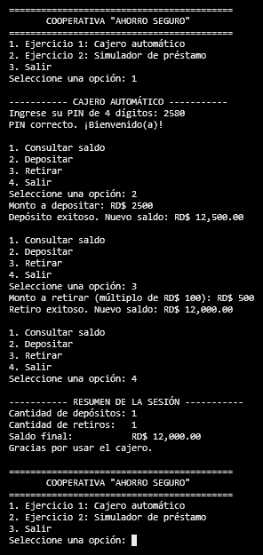
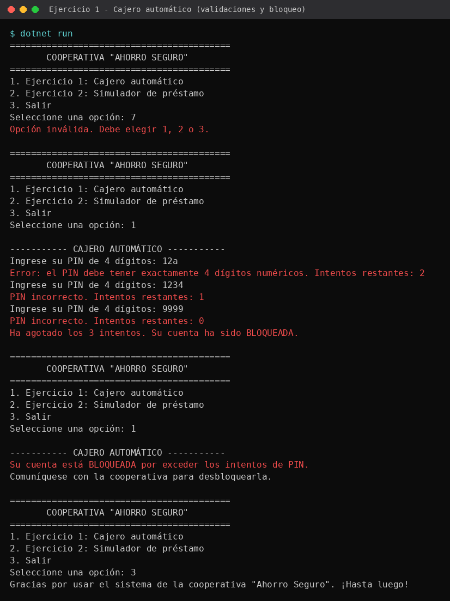
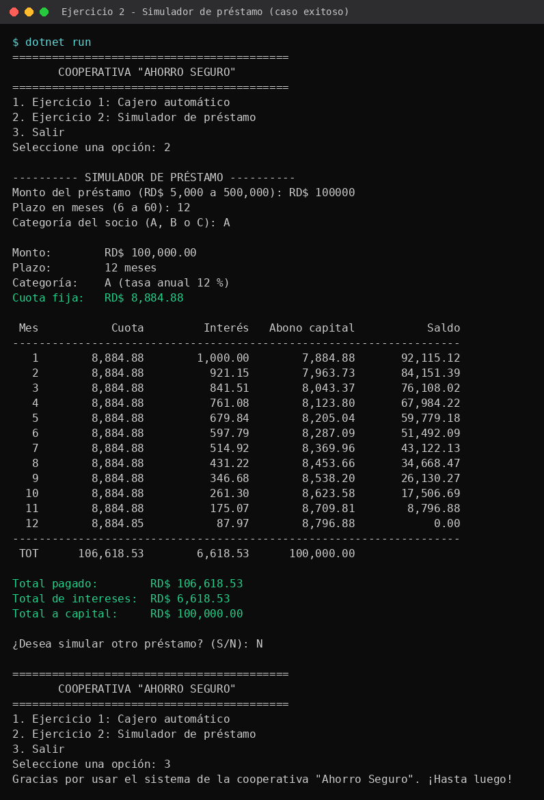
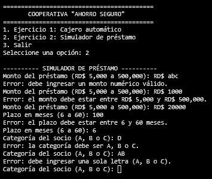

# Cooperativa "Ahorro Seguro" – Estructuras de control en C#

**Asignatura:** Algoritmos Computacionales
**Profesor:** Gamalier Reyes del Carmen
**Actividad:** Actividad grupal – Estructuras de control

---

## 1. Datos de los autores

| Nombre completo | Matrícula |
|-----------------|-----------|
| Roger Ciprián Scroggin | 26-ESON-2-012 |
| Laudy Mejía | 25-MISN-2-011 |
| Dean Boris Georges Trubina | 26-EISN-2-042 |
| Wilfy Paulino Martínez | 21-EISN-2-042 |
| Daniel Antonio Mañón | 26-ESON-2-012 |
| Albhery Severino | 25-EISN-2-048 |

---

## 2. Descripción del proyecto

Prototipo de aplicación de consola en C# para la cooperativa "Ahorro Seguro", que moderniza dos procesos manuales. Es **un solo proyecto** con un **menú principal** (Ejercicio 1, Ejercicio 2, Salir) que se repite hasta que el usuario elige "Salir".

- **Ejercicio 1 – Cajero automático:** el socio se autentica con un PIN de 4 dígitos (3 intentos; si falla, la cuenta se bloquea). Con el PIN correcto puede consultar su saldo, depositar y retirar desde un menú repetitivo. Al salir se muestra un resumen de la sesión.
- **Ejercicio 2 – Simulador de préstamo:** solicita monto, plazo y categoría del socio, calcula la cuota fija mensual, muestra la tabla de amortización y los totales pagados. Permite simular otro préstamo mientras el usuario responda "S".

Estructuras de control utilizadas: `if / else if / else`, `switch`, `for`, `while` y `do-while`. Todas las entradas se validan con `TryParse`.

Restricciones cumplidas: no se usa `foreach`, `goto`, arreglos, funciones propias, listas, colecciones ni paquetes externos.

---

## 3. Datos de entrada

**Menú principal**
- Opción del menú: `1`, `2` o `3` (entero).

**Ejercicio 1 – Cajero automático**
- PIN de 4 dígitos (PIN de prueba: `2580`).
- Opción del menú del cajero: `1` Consultar saldo, `2` Depositar, `3` Retirar, `4` Salir.
- Monto a depositar (decimal).
- Monto a retirar (decimal).

**Ejercicio 2 – Simulador de préstamo**
- Monto del préstamo (decimal, entre RD$ 5,000 y RD$ 500,000).
- Plazo en meses (entero, entre 6 y 60).
- Categoría del socio (`A`, `B` o `C`).
- Respuesta para simular otro préstamo (`S` / `N`).

---

## 4. Datos que procesa

**Ejercicio 1**
- Compara el PIN ingresado con el PIN definido en el código y cuenta los intentos (máximo 3). Si se agotan, la cuenta queda bloqueada.
- Saldo inicial: **RD$ 10,000.00**.
- **Depósito:** debe ser mayor que cero. Se suma al saldo y se incrementa el contador de depósitos.
- **Retiro:** debe ser mayor que cero, no mayor al saldo y múltiplo de RD$ 100. Se resta del saldo y se incrementa el contador de retiros.

**Ejercicio 2**
- Tasa anual según la categoría:

  | Categoría | Tasa anual |
  |-----------|-----------|
  | A | 12 % |
  | B | 15 % |
  | C | 18 % |

- Tasa mensual: `i = tasa anual / 12`.
- Cuota fija mensual:

  ```
  Cuota = Monto × [ i (1 + i)^n ] / [ (1 + i)^n − 1 ]
  ```

- Para cada mes: `Interés = Saldo × i`, `Abono a capital = Cuota − Interés`, `Saldo = Saldo − Abono`. En el último mes se ajustan los centavos de redondeo para que el saldo termine en 0.
- Acumula el total pagado, el total de intereses y el total abonado a capital.

---

## 5. Datos de salida

**Ejercicio 1**
- Mensajes de PIN incorrecto con intentos restantes, o de cuenta bloqueada.
- Saldo actual y nuevo saldo tras cada operación.
- Mensajes de error de validación (monto inválido, fondos insuficientes, no múltiplo de 100, etc.).
- Al salir: **cantidad de depósitos, cantidad de retiros y saldo final**.

**Ejercicio 2**
- Resumen del préstamo: monto, plazo, categoría, tasa y cuota fija.
- **Tabla de amortización** con: mes, cuota, interés, abono a capital y saldo.
- **Totales:** total pagado, total de intereses y total abonado a capital.

---

## 6. Tecnología utilizada

- Lenguaje: **C#**
- Plataforma: **.NET 8** (aplicación de consola)
- Editor / IDE: Visual Studio 2022 / Visual Studio Code
- Control de versiones: **Git** y **GitHub**

### Cómo ejecutar

```bash
git clone https://github.com/daonyl2311-design/algoritmo-flujo.git
cd algoritmo-flujo
dotnet run
```

---

## 7. Capturas del programa

### Ejercicio 1 – Cajero automático

**Caso exitoso** (PIN correcto, depósito, retiro y resumen al salir):



**Caso de error / validación** (PIN incorrecto, cuenta bloqueada o retiro inválido):



### Ejercicio 2 – Simulador de préstamo

**Caso exitoso** (tabla de amortización y totales):



**Caso de error / validación** (monto, plazo o categoría inválidos):


